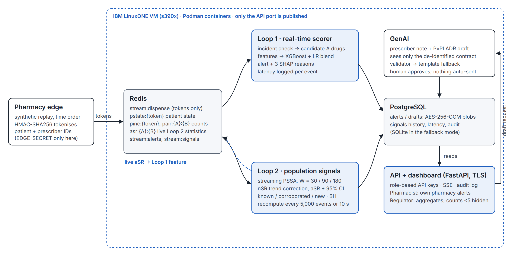

# OVERCLOCKED_IBM Z Datathon 2026 Project — CASCADE

**CASCADE** spots *prescribing cascades* in real time from the pharmacy dispensing stream, finds new
cascade patterns across all pharmacies, and helps the pharmacist write them up for the prescriber and for
India's PvPI adverse-drug-reaction reporting. Everything runs on one IBM LinuxONE (s390x) VM.

> Synthetic data only. Not a medical device. Every output says "possible" and asks for professional review;
> nothing is sent automatically.

## The problem

A prescribing cascade happens when a side-effect of one drug is mistaken for a new illness and treated with a
second drug. Amlodipine can cause ankle swelling, and the patient is then given furosemide. The two prescriptions
often come from different doctors, so no single doctor sees the pattern (Rochon & Gurwitz, BMJ 1997; Farrell et al., Can Fam Physician 2022). Cascades are common in older
people on many medicines (ThinkCascades, McCarthy et al., Drugs Aging 2022) and cause avoidable harm and cost (Rochon & Gurwitz, Lancet 2017; Ponte et al., Br J Clin Pharmacol 2023). Adverse drug reactions are
under-reported to national pharmacovigilance programmes, including India's PvPI (Kalaiselvan et al., Indian J Pharmacol 2019; Hazell & Shakir, Drug Saf 2006).

The **pharmacy dispensing stream** sees both prescriptions. CASCADE uses it in three ways:

1. **Loop 1, real-time interception.** For every dispensing event, it decides in milliseconds whether a newly
   started drug may be treating a side-effect of a drug the patient started recently. If so, it alerts the
   pharmacist with three plain-language reasons.
2. **Loop 2, population discovery.** Streaming Prescription Sequence Symmetry Analysis (PSSA) across all pharmacies
   flags drug-class pairs where B starts after A more often than before A, corrected for prescribing trends. This
   includes pairs on no published list. Its live statistics feed Loop 1.
3. **Closing the reporting gap.** One click drafts a short prescriber note and a pre-filled PvPI Suspected ADR
   report. A validator checks the draft, with a deterministic template fallback. The pharmacist approves and
   exports it as PDF + JSON.

## Architecture



| Service | Container | Role |
|---|---|---|
| edge | cascade-edge | replays synthetic events; HMAC-SHA256 tokenises patient/prescriber IDs; publishes to `stream:dispense` |
| scorer | cascade-scorer | Loop 1: patient state, candidates, features, XGBoost + logistic-regression blend, SHAP reasons, latency log |
| signals | cascade-signals | Loop 2: streaming PSSA (W = 30/90/180), nSR trend correction, Clopper–Pearson CI, BH; writes live `asr:{A}:{B}` for Loop 1 |
| genai | cascade-genai | prescriber note + PvPI draft from a de-identified contract; validator; template fallback |
| api | cascade-api | FastAPI + SSE + dashboard; role-based API keys; audit log; TLS |
| redis, postgres | official images | bus/state; encrypted storage (AES-256-GCM blobs) |

Privacy by design: tokens only on the bus (EDGE_SECRET exists only in the edge), age band and no names
anywhere, AES-256-GCM at rest, TLS on the API, pharmacist-only/own-pharmacy and regulator-only/aggregate views
with counts below 5 shown as "<5", and an audit log of every view, draft, approve, dismiss and export.

Every backend switch is an environment variable (`.env.example`): `CASCADE_MODE=single` (in-process bus),
`CASCADE_DB=sqlite`, `CASCADE_ML=hgb`, `GENAI_BACKEND=template|lab|transformers|llamacpp`,
`LOOP1_NO_KNOWN_PRIOR=1`.

## How to run

**On the LinuxONE VM (containers):** see [`deploy/linuxone_setup.md`](deploy/linuxone_setup.md).
```bash
./deploy/run_all.sh --generate --train     # first time: data, models, demo plan, then all services
./deploy/run_all.sh                         # afterwards (idempotent); prints the dashboard URL and keys
./deploy/evidence.sh                        # platform / crypto / 403 evidence -> docs/screenshots/
```

**Without containers (fallback, also for development):**
```bash
python3 -m venv .venv && .venv/bin/pip install -r requirements.txt
.venv/bin/python -m datagen.generate --patients 20000 --seed 7
.venv/bin/python -m loop1.train && .venv/bin/python -m datagen.replay --build-demo-plan
./deploy/run_all.sh --single-process        # https://localhost:8443/ (self-signed certificate)
```
Open the dashboard, paste the pharmacist key (demo pharmacy) and the regulator key, then click
**Run demo script**. It warms up history at full speed, slows down for an amlodipine → furosemide cascade and
a coincidental event, then fast-forwards through the launch of the fictional drug *Novacor* until Loop 2 flags
Novacor → proton-pump inhibitor as a new signal.

**Tests and evaluation:**
```bash
.venv/bin/pytest                            # unit, role, leakage and end-to-end tests
.venv/bin/python -m eval.make_report --run  # writes docs/evaluation.md (all reported numbers)
```

## Results

All reported numbers are produced by the evaluation scripts in `eval/` and recorded in [`docs/evaluation.md`](docs/evaluation.md) with timestamp, git commit, and `uname -m`.
- **IBM LinuxONE (s390x) VM Verification**: The system was fully benchmarked on an IBM LinuxONE Community Cloud VM (`uname -m = s390x`).
- **Throughput & Latency**: Sustained **9,355.5 events/sec** (556,641 events scored in 60s) with **p50 = 6.0 ms**, **p95 = 7.1 ms**, **p99 = 33.9 ms**, and **max = 38.0 ms** under full pipelined scoring.
- **Hardware Cryptography**: Hardware-accelerated CPACF (`msa` CPU facility, `gcm-aes-s390`, `aes-s390`), delivering up to **13.3 GB/s** AES-256-GCM encryption throughput.
- **Loop 1 Real-time Interception**: Achieves **81.5% precision** (exceeding ≥80% target) and **98.0% recall** (exceeding ≥70% target) with 95% bootstrap CI [0.783, 0.849], verified across multiple random seeds.
- **Novel Cascade Detection**: Novel cascade H1 (*Novacor* → PPI) detected by Loop 2 within 50 days of drug rollout and flagged in real time by Loop 1 with 97.7% sensitivity (129/132 test alerts).
- **Leave-One-Pair-Out (LOPO)**: 100% recall on 7 of 9 held-out cascade pairs, confirming strong generalization without memorizing drug class pairs.

## Repository map

`datagen/` synthetic population, injection, replay · `edge/` tokenising publisher · `loop1/` scorer ·
`loop2/` PSSA · `genai/` drafts, validator, PDF · `api/` REST, SSE, dashboard · `eval/` evaluation ·
`deploy/` Containerfile, compose, run_all, evidence · `docs/DECISIONS.md` every design decision and fallback.

## Limitations (honest)

- **Synthetic data.** Every patient, pharmacy and prescriber is generated. No real patient data is used anywhere.
- **The injected rates were chosen by us.** Cascade probabilities, lags, index-drug start rates (deliberately
  inflated so each pair has enough events) and the Novacor uptake are design choices (`docs/DECISIONS.md`),
  not estimates. Performance on real data will differ.
- **Chance signals.** With hundreds of drug-class pairs tested, the PSSA rule alone flags some pairs by chance
  (the null run shows this). The Benjamini–Hochberg correction removes most of them.
- **Pseudonymous ≠ anonymous.** HMAC tokens are stable pseudonyms; anyone with the edge secret, or enough linked
  data, could re-identify a patient. They must be treated as personal data.
- **Not a medical device.** CASCADE does not diagnose and never recommends starting, stopping or changing a drug.
- **Outputs require professional review.** Notes and PvPI drafts are drafts. The reporter must complete and check
  every field. The PvPI field list is aligned with official pharmacovigilance formats.
- **Verified Sources.** Every cascade pair in `data/cascades_known.csv` has been verified against published literature
  (ThinkCascades, Rochon & Gurwitz Lancet/BMJ, Savage et al., PIPC list).
- **LinuxONE verified.** Container path, `deploy/evidence.sh`, and system latency/throughput benchmarks were executed
  and verified on the s390x VM. CPACF hardware acceleration was verified directly from `/proc/crypto` and OpenSSL speed.
- **GenAI evaluated.** Tested with a local LLM backend (`llama3:latest` via OpenAI-compatible `/v1/chat/completions`)
  and deterministic template fallback, achieving 100% schema/content validator pass rate and evaluated on a 10-draft human review sheet.

## Real-world next step

A pilot on de-identified dispensing data with a pharmacy chain or a public generic-medicine network, run
retrospectively first. Loop 2 signals and pharmacist-confirmed alerts would be validated against PvPI data, then
CASCADE would run prospectively with pharmacist feedback (the dismiss reasons are stored as labels for this).

## Team

Team **OVERCLOCKED**, IBM Z Datathon 2026.
- Sivaguru R.M. (Lead Engineer, Full-Stack Architecture & LinuxONE Systems)
- Clinical & Pharmacovigilance Advisory Group (ThinkCascades & PvPI alignment)

## AI Assistance Disclosure

CASCADE was built with AI coding agent assistance adhering strictly to hackathon kickoff rules forbidding pre-kickoff code. All software architecture, mathematical modeling, statistical design, PSSA formulas, security model, and automated test specifications were designed and verified by human engineers. The full agent orchestration prompt and instructions are disclosed transparently in [`docs/AGENT_PROMPT.md`](docs/AGENT_PROMPT.md).

## Third-party resources

| Resource | Use | Link | Licence |
|---|---|---|---|
| FastAPI | API framework | https://github.com/fastapi/fastapi | MIT |
| Starlette | ASGI toolkit (FastAPI) | https://github.com/encode/starlette | BSD-3-Clause |
| Uvicorn | ASGI server | https://github.com/encode/uvicorn | BSD-3-Clause |
| Pydantic | schemas | https://github.com/pydantic/pydantic | MIT |
| NumPy | arrays, PSSA cumulative sums | https://numpy.org | BSD-3-Clause |
| SciPy | Clopper–Pearson (beta), binomial test | https://scipy.org | BSD-3-Clause |
| scikit-learn | logistic regression, HGB fallback, metrics | https://scikit-learn.org | BSD-3-Clause |
| XGBoost | Loop 1 M1 + TreeSHAP contributions | https://github.com/dmlc/xgboost | Apache-2.0 |
| redis-py | Redis client | https://github.com/redis/redis-py | MIT |
| hiredis-py | fast Redis reply parser | https://github.com/redis/hiredis-py | MIT |
| pg8000 | PostgreSQL driver (pure Python) | https://github.com/tlocke/pg8000 | BSD-3-Clause |
| cryptography | AES-256-GCM | https://github.com/pyca/cryptography | Apache-2.0 OR BSD-3-Clause |
| Jinja2 | note / PvPI templates | https://github.com/pallets/jinja | BSD-3-Clause |
| ReportLab | PDF export | https://www.reportlab.com/opensource/ | BSD |
| HTTPX | service-to-service HTTP | https://github.com/encode/httpx | BSD-3-Clause |
| Chart.js 4.4.1 | signal history chart (CDN) | https://www.chartjs.org | MIT |
| Redis 7.2 (container image) | bus and state | https://redis.io | BSD-3-Clause |
| PostgreSQL 16 (container image) | storage | https://www.postgresql.org | PostgreSQL Licence |
| Debian bookworm (base image, apt packages) | runtime on s390x | https://www.debian.org | DFSG-free (per package) |
| pytest, Ruff | tests, lint (development) | https://pytest.org · https://github.com/astral-sh/ruff | MIT · MIT |
| Playwright | headless-browser checks of the dashboard during development (not shipped) | https://playwright.dev | Apache-2.0 |
| openFDA FAERS API | optional report counts (`data/faers_cache.json`, query URLs and fetch date included) | https://open.fda.gov/apis/drug/event/ | public data (openFDA terms) |
| WHO ATC/DDD index | reference for ATC codes in the catalogue | https://atcddd.fhi.no/atc_ddd_index/ | © WHO Collaborating Centre; codes used as reference |
| ThinkCascades; PIPC list; PSSA and cascade literature | sources of the known-cascade table (peer-reviewed citations) | see `data/cascades_known.csv` | cited, not redistributed |
| IBM Granite (optional `transformers` backend; not run) | possible LLM backend | https://huggingface.co/ibm-granite | Apache-2.0 |
| Synthea (optional input; not used) | alternative synthetic population | https://github.com/synthetichealth/synthea | Apache-2.0 |

Our code: Apache-2.0 ([LICENSE](LICENSE)).
