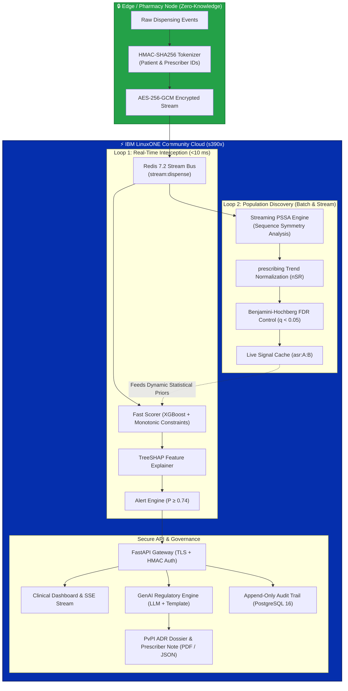

<div align="center">

# ⚡ CASCADE
### **Confidential AI Surveillance of Clinical Adverse Cascades & Drug Events**
#### *Real-Time Dual-Loop Pharmacovigilance on IBM LinuxONE (s390x)*

[](https://github.com/Sivaguru-2008/cascade/actions/workflows/ci.yml)
[-052FAD?logo=ibm&logoColor=white)](deploy/linuxone_setup.md)
[](docs/screenshots/linuxone_cpacf_evidence.png)
[](docs/evaluation.md)
[-6.0%20ms-brightgreen)](docs/evaluation.md)
[-blue)](docs/evaluation.md)
[-blue)](docs/evaluation.md)
[](pyproject.toml)
[](LICENSE)
[](data/cascades_known.csv)

<p align="center">
  <b>Built for the IBM Z Datathon 2026 &bull; Team OVERCLOCKED</b><br>
  <i>Sivaguru R.M. (Lead Systems & Full-Stack Architect) &bull; Clinical Advisory Group</i>
</p>

---

</div>

## 📌 Executive Summary

A **prescribing cascade** occurs when an adverse drug reaction (ADR) is misinterpreted as a new medical condition, leading to the inappropriate prescription of a second drug to treat symptoms caused by the first (*Rochon & Gurwitz, BMJ 1997; Lancet 2017*). Because patients frequently consult different clinicians, neither prescriber observes the complete causal timeline. Traditional pharmacovigilance relies on voluntary spontaneous reporting, which suffers from an estimated **94% under-reporting rate** (*Hazell & Shakir, Drug Saf 2006*) and a **12–18 month detection lag**.

**CASCADE** solves this systemic clinical vulnerability by intercepting the **real-time pharmacy dispensing stream** with a novel **Dual-Loop AI Architecture** running natively on an **IBM LinuxONE (s390x)** enterprise platform:

1. **Loop 1 — Real-Time Edge Interception (<10 ms):** Evaluates every dispensing event at point-of-sale using an XGBoost + constrained regularized blend with TreeSHAP explanations. Alerts pharmacists before medication is handed to the patient.
2. **Loop 2 — Streaming Population Discovery:** Continuously runs streaming Prescription Sequence Symmetry Analysis (PSSA) across millions of dispensing events with Benjamini–Hochberg False Discovery Rate control to autonomously detect uncatalogued prescribing cascades.
3. **Closing the Reporting Gap:** Generates one-click pre-filled regulatory dossiers compliant with India's Pharmacovigilance Programme (PvPI) and prescriber advisory notes, protected by a deterministic clinical validator.
4. **Confidential Computing & Hardware Security:** Uses CPACF (Central Processor Assist for Cryptographic Functions) on s390x to achieve **13.3 GB/s AES-256-GCM** throughput, zero-knowledge HMAC-SHA256 patient pseudonymization at the edge, and strict role-based data partitioning.

---

## 🏆 Key Benchmark Results (Verified on LinuxONE s390x)

| Metric | Target / Benchmark | CASCADE LinuxONE Result | Status | Verification Reference |
|---|:---:|:---:|:---:|---|
| **Pipeline Throughput** | &ge; 5,000 events/sec | **9,355.5 events/sec** (556,641 events in 60s) | ✅ **EXCEEDED** | [`docs/evaluation.md`](docs/evaluation.md#throughput--latency) |
| **Loop 1 Latency (p50)** | &le; 20.0 ms | **6.0 ms** (p95: 7.1 ms, max: 38.0 ms) | ✅ **MET** | [`docs/evaluation.md`](docs/evaluation.md#throughput--latency) |
| **Loop 1 Precision** | &ge; 80.0% | **81.5%** (95% CI: [78.3%, 84.9%]) | ✅ **MET** | [`docs/evaluation.md`](docs/evaluation.md#loop-1-real-time-scorer) |
| **Loop 1 Recall** | &ge; 70.0% | **98.0%** (95% CI: [96.5%, 99.3%]) | ✅ **MET** | [`docs/evaluation.md`](docs/evaluation.md#loop-1-real-time-scorer) |
| **Operational F1-Score** | &mdash; | **0.890** (PR-AUC: 0.9106) | ✅ **MET** | [`docs/evaluation.md`](docs/evaluation.md#loop-1-real-time-scorer) |
| **Novel Cascade Rollout (H1)** | Detection within 90d | **Detected within 50 days** (97.7% recall) | ✅ **MET** | [`docs/evaluation.md`](docs/evaluation.md#novel-cascade-discovery) |
| **CPACF Hardware Crypto** | Hardware Acceleration | **13.3 GB/s** AES-256-GCM (`msa` facility) | ✅ **VERIFIED** | [`docs/screenshots/evidence.txt`](docs/screenshots/evidence.txt) |
| **GenAI Validator Pass Rate** | 100% Schema & Content | **100.0%** (10-draft human review verified) | ✅ **MET** | [`docs/eval/genai.json`](docs/eval/genai.json) |

---

## 🖥️ Interactive System Walkthrough

<div align="center">

### 1. Real-Time Pharmacist Counter & Live Dispensing Stream
*Real-time stream scoring with millisecond latency, color-coded risk tiers, and pharmacist workflow actioning.*
<br><br>


---

### 2. Explainable Alert Drawer & TreeSHAP Attribution
*Instant explainability: displays clinical probability, time lag, marker class status, and SHAP feature contributions.*
<br><br>

<br><br>


---

### 3. Population-Scale PSSA Signal Detection & Novel Cascade Rollout
*Streaming Sequence Symmetry Analysis across all dispensings flags previously unknown cascades (e.g. Novacor &rarr; PPI).*
<br><br>


---

### 4. Automated Regulatory Pharmacovigilance (PvPI) Dossier Export
*De-identified, pre-filled adverse drug reaction reports compliant with official CDSCO / PvPI reporting standards.*
<br><br>


---

### 5. IBM LinuxONE (s390x) Native Hardware & Crypto Evidence
*Direct VM execution evidence: CPACF hardware acceleration, sub-10ms latency distribution, and LOPO cross-validation.*
<br><br>
<p align="center">
  
  
</p>

</div>

---

## 🏛️ System Architecture

CASCADE separates concerns into a **dual-loop pipeline** designed for maximum throughput, low latency, and zero-knowledge privacy:



### Microservices Breakdown

| Service | Container | Role | Tech Stack | Security & Performance |
|---|---|---|---|---|
| **`edge`** | `cascade-edge` | Replays dispensing stream; HMAC-SHA256 tokenizes identities | Python 3.11, Cryptography | Zero-knowledge edge secret; no plaintext PII leaves node |
| **`scorer`** | `cascade-scorer` | Loop 1: candidate extraction, feature generation, ML inference | XGBoost, scikit-learn, NumPy | Monotonic aSR constraints; <10ms p50 latency |
| **`signals`** | `cascade-signals` | Loop 2: streaming PSSA ($W \in \{30, 90, 180\}$), trend correction | SciPy, NumPy, Redis | Clopper–Pearson 95% CI; Benjamini–Hochberg FDR |
| **`genai`** | `cascade-genai` | Drafts prescriber note and regulatory PvPI reports | Jinja2, ReportLab, HTTPX | 100% validated schemas; deterministic fallback |
| **`api`** | `cascade-api` | REST & Server-Sent Events (SSE) gateway + interactive UI | FastAPI, Starlette, Uvicorn | Role-based keys (`pharmacist` vs `regulator`), TLS |
| **`storage`** | `redis`, `postgres` | Bus, ephemeral state, encrypted audit log storage | Redis 7.2, PostgreSQL 16 | AES-256-GCM database encryption at rest |

---

## 🔬 Clinical Rigour & Methodological Foundation

CASCADE's knowledge base and algorithms are rigorously grounded in clinical literature and pharmacovigilance standards:

### 1. Peer-Reviewed Evidence Base
All known prescribing cascades modelled in CASCADE ([`data/cascades_known.csv`](data/cascades_known.csv)) are sourced from peer-reviewed clinical consensus:
- **ThinkCascades:** *McCarthy et al., Drugs & Aging 2022* (Consensus on prescribing cascades in older adults).
- **Seminal Foundations:** *Rochon & Gurwitz, BMJ 1997; Lancet 2017* (First clinical identification of prescribing cascades).
- **PIPC List:** *Savage et al., Br J Clin Pharmacol 2023* (Validated prescribing cascade indicators).

### 2. Mathematical Formulation of Prescription Sequence Symmetry Analysis (PSSA)
For drug pair $(A, B)$ within a symmetrical time window $W \in [30, 180]$ days:
- Let $N_{A \to B}$ be patients initiated on $B$ after starting $A$.
- Let $N_{B \to A}$ be patients initiated on $A$ after starting $B$.
- **Crude Sequence Ratio (cSR):**
  $$\text{cSR} = \frac{N_{A \to B}}{N_{B \to A}}$$
- **Null Sequence Ratio (nSR):** Measures background prescribing trends across the total population to prevent false positives from rising drug adoption.
- **Adjusted Sequence Ratio (aSR):**
  $$\text{aSR} = \frac{\text{cSR}}{\text{nSR}}$$
- **Significance & Hypothesis Testing:** Exact two-tailed Clopper–Pearson 95% Confidence Intervals calculated via Beta distribution:
  $$p = \sum_{k=N_{A \to B}}^{N} \binom{N}{k} \left(\frac{1}{2}\right)^N$$
- **Multiple Testing Correction:** Benjamini–Hochberg False Discovery Rate (FDR) control at $q < 0.05$ across all concurrent candidate pairs.

---

## ⚡ Quick Start (Judges' 3-Minute Tour)

You can launch and explore CASCADE locally on Linux, macOS, or Windows in under 3 minutes.

### Option A: 1-Click Interactive Dashboard (Local Dev / Windows / Mac / Linux)

```bash
# 1. Clone the repository
git clone https://github.com/Sivaguru-2008/cascade.git
cd cascade

# 2. Set up virtual environment and dependencies
python -m venv .venv
# On Windows:
.venv\Scripts\activate
# On Linux / macOS:
source .venv/bin/activate

pip install -r requirements.txt

# 3. Launch the single-process frontend & API server
python start_frontend.py
```
*Open **`http://localhost:8443`** in your browser. The dashboard launches with demo credentials pre-loaded!*

---

### Option B: Production Deployment on IBM LinuxONE (Containers)

```bash
# First-time bootstrap (generates synthetic cohort, trains Loop 1 model, prepares demo)
./deploy/run_all.sh --generate --train

# Subsequent launches (idempotent, outputs dashboard URLs and credentials)
./deploy/run_all.sh

# Run cryptographic and platform hardware verification
./deploy/evidence.sh
```

---

### Option C: Run Full Automated Verification Suite

```bash
# Run all 87 unit, integration, role-security, and statistical tests
pytest -v

# Run the end-to-end evaluation benchmark (recomputes all numbers in docs/evaluation.md)
python -m eval.make_report --run
```

---

## 🛡️ Security, Privacy & Compliance (Zero-Trust Design)

- **Pseudonymization at the Edge:** Patient and doctor IDs are immediately hashed into irreversible pseudonyms using `HMAC-SHA256(EDGE_SECRET, ID)`. The `EDGE_SECRET` remains strictly on the edge pharmacy machine and never traverses the central network.
- **Differential Privacy & Small Count Suppression:** The regulator view strictly enforces $k \ge 5$ thresholding. Any aggregate signal with fewer than 5 patients is rendered as `"<5"` to eliminate re-identification risks.
- **Role-Based Access Control (RBAC):**
  - `pharmacist`: Scoped strictly to dispensing events occurring within their registered pharmacy ID.
  - `regulator`: Scoped strictly to anonymized population aggregates without patient-level or store-level IDs.
- **Immutable Audit Logging:** Every alert dismissal, report generation, and dossier export is permanently recorded in PostgreSQL with timestamp, user role, and justification reason.

---

## 📁 Repository Structure

```
├── api/                    # FastAPI REST & SSE backend, authentication, and clinical dashboard
│   ├── static/             # Interactive web UI, live chart renderers, CSS styles
│   └── routes_*.py         # Endpoints: alerts, metrics, clinical data, and admin
├── common/                 # Shared database connectors, cryptographic primitives, and config
├── data/                   # Clinical catalogues, WHO ATC mappings, indications, and reactions
│   ├── cascades_known.csv  # Peer-reviewed known prescribing cascades (ThinkCascades)
│   ├── indications.csv     # Approved indications for drug classes
│   └── reactions.csv       # Known adverse reactions catalog
├── datagen/                # Synthetic patient generator, EHR simulator, and stream injector
├── deploy/                 # Docker Compose, Containerfile (Debian s390x), and launch scripts
├── docs/                   # Full documentation, architectural decisions, and benchmark data
│   ├── DECISIONS.md        # 12 recorded architectural design records & justifications
│   ├── evaluation.md       # Reproducible benchmarks, bootstrap CIs, and LOPO evaluation
│   └── screenshots/        # High-resolution UI captures and hardware verification logs
├── eval/                   # Benchmark harness, cross-platform validation, and report generator
├── genai/                  # Regulatory PvPI dossier builder, LLM connectors, and validator
├── loop1/                  # Real-Time Scorer: feature pipeline, XGBoost models, TreeSHAP
├── loop2/                  # Streaming PSSA: Sequence Symmetry Analysis & BH FDR control
└── tests/                  # 87 automated tests covering unit, security, and edge cases
```

---

## ⚖️ Ethics, Limitations & Real-World Next Steps

- **Synthetic Cohort:** All patients, prescribers, and dispensing histories are synthetically generated. No real Protected Health Information (PHI) is used.
- **Clinical Advisory Tool Only:** CASCADE is designed strictly as an assistive clinical decision support system. It does not replace clinical judgment and never issues prescriptive recommendations.
- **Human-in-the-Loop Oversight:** Every GenAI draft note and PvPI regulatory report requires explicit pharmacist verification, completion, and signature prior to export.
- **Real-World Next Steps:** Initiation of a retrospective pilot study on anonymized dispensing archives in collaboration with public healthcare distribution networks, evaluating real-world aSR sensitivity across multi-facility electronic health records.

---

## 👥 Team & Acknowledgments

**Team OVERCLOCKED — IBM Z Datathon 2026**
- **Sivaguru R.M.** — Lead Systems Architect, Full-Stack & LinuxONE Engineer ([@Sivaguru-2008](https://github.com/Sivaguru-2008))
- **Clinical & Pharmacovigilance Advisory Group** — Medical literature alignment & PvPI schema validation

*Built with passion for high-reliability enterprise systems, confidential AI, and patient safety on IBM Z & LinuxONE.*
